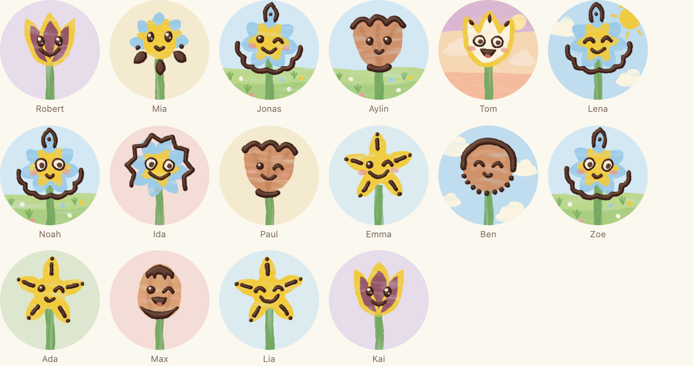

# Glaze Flowers

Happy flower avatars in the look of a hand-painted, glazed ceramic vase. One seed, one flower – always the same one.



[Gallery of all flowers, eyes and backgrounds](https://root-bert.github.io/glaze-flowers/)

- 11 flowers, 5 pairs of eyes, 4 mouths, optional cheeks – all of them happy
- 6 plain backgrounds, 3 meadows, 3 skies
- Pure SVG, no dependencies, works in the browser and on the server
- Also available as a [DiceBear](https://www.dicebear.com) style definition
- Free for everyone, no credit needed ([CC0 1.0](LICENSE))

## Install

```sh
npm install glaze-flowers
# or
bun add glaze-flowers
```

## Use

```js
import { createFlower, createFlowerDataUri } from 'glaze-flowers';

const svg = createFlower({ seed: 'Robert' });

// Round, with a background picked by the seed
const avatar = createFlower({ seed: 'robert@example.com', background: 'auto', radius: 50 });

// As an image source
img.src = createFlowerDataUri({ seed: 'Robert', background: 'meadow' });
```

### Options

| Option       | Values                                                                                                         | Default         |
| ------------ | -------------------------------------------------------------------------------------------------------------- | --------------- |
| `seed`       | any string                                                                                                     | `'flower'`      |
| `flower`     | `star` `ball` `tulipBrown` `tulipPurple` `tulipYellow` `cornflower` `flame` `calyx` `bud` `bandBall` `disc`      | from the seed   |
| `eyes`       | `dot` `arc` `big` `googly` `wink`                                                                              | from the seed   |
| `mouth`      | `smile` `wide` `open` `small`                                                                                  | from the seed   |
| `cheeks`     | `true` `false`                                                                                                 | from the seed   |
| `background` | `cream` `lightBlue` `rose` `sage` `butter` `lilac`, `meadow` `meadowHills` `meadowFlowers`, `sky` `skySun` `skyDusk`, any CSS colour, `auto`, `transparent` | `'cream'`       |
| `radius`     | corner radius in percent, `50` is a circle                                                                     | `0`             |
| `size`       | sets `width` and `height` on the `<svg>`                                                                       | none (scales)   |
| `texture`    | `false` turns the brush and glaze filters off (flat shapes for Figma import or very small sizes)              | `true`          |

The brush strokes and the glossy glaze are SVG filters. Browsers render them; some design tools drop filters on import – use `texture: false` there.

## With DiceBear

The same parts ship as a DiceBear style definition (`@dicebear/core` 10 or newer):

```js
import { Avatar, Style } from '@dicebear/core';
import definition from 'glaze-flowers/dicebear' with { type: 'json' };

const svg = new Avatar(new Style(definition), { seed: 'Robert', borderRadius: 50 }).toString();
```

Options follow DiceBear's rules: `flowerVariant`, `eyesVariant`, `mouthVariant`, `sceneVariant`, `cheeksProbability`, `sceneProbability`, `backgroundColor`.

## Develop

```sh
npm install
npm run build   # writes docs/ (gallery) and dicebear/glaze-flowers.json
npm test
```

All shapes live in [`src/flowers.mjs`](src/flowers.mjs). The DiceBear definition is generated from it, so both stay identical.

## Licence

[CC0 1.0 Universal](LICENSE) – code and artwork are dedicated to the public domain. Use them for anything, without asking and without credit.
